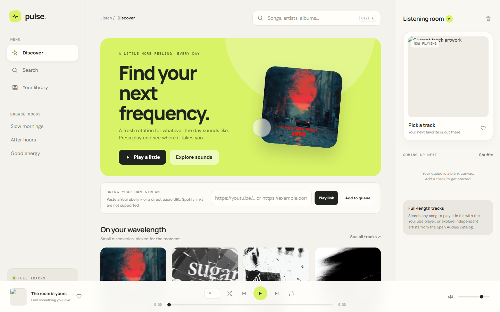

<div align="center">

# 🎧 Pulse Player

### *Find your next frequency.*

A bright, browser-based music player: search any song, play it in full, build a queue, and save favorites. No account, no API key, no install.

[](https://pulse-player-0rdw.onrender.com/)


**[🌐 Live Player](https://pulse-player-0rdw.onrender.com/)** · **[🐛 Report Bug](https://github.com/digvijay165/pulse-player/issues)** · **[✨ Request Feature](https://github.com/digvijay165/pulse-player/issues)**

<br>

<a href="https://pulse-player-0rdw.onrender.com/">
  
</a>

</div>

---

## 📖 About

**Pulse** is a music discovery player that runs entirely in your browser. Search mainstream hits through **YouTube** or independent artists through the open **Audius** catalog, and play full-length tracks. You can also paste a YouTube link or a direct audio URL, line songs up in a queue, and keep your favorites on your device.

It's a single `index.html` file, so there's no build step, no backend, and no sign-up.

> 🔗 **Try it live:** [pulse-player-0rdw.onrender.com](https://pulse-player-0rdw.onrender.com/)

---

## ✨ Features

| Feature | Description |
| --- | --- |
| 🔍 **Search any song** | Free YouTube search (no key needed) plus the open Audius API |
| ▶️ **Full-length playback** | Play complete tracks, not 30-second previews |
| 🔗 **Bring your own stream** | Paste a YouTube link or a direct HTTPS audio URL |
| 📜 **Smart queue** | Play, reorder, remove, and clear queued tracks |
| 🔁 **Playback controls** | Seek, volume, repeat, and shuffle |
| ⚡ **Speed control** | Anywhere from **0.5× to 4×** |
| ❤️ **Favorites** | Saved in your browser along with your speed setting |
| 🎭 **Browse moods** | *Slow mornings*, *After hours*, *Good energy*, and more |
| ⌨️ **Keyboard shortcuts** | Fast control without touching the mouse |
| 📱 **Responsive** | Designed for phones, tablets, and desktops |
| 🚫 **Zero setup** | No account, API key, build step, or installation |

---

## 🎵 Music Sources

| Priority | Source | What Pulse supports |
| :---: | --- | --- |
| 1️⃣ | **YouTube** (IFrame Player + search) | Search any song, including mainstream hits, and play it in full in the embedded YouTube player |
| 2️⃣ | **Audius API** | Search results, artwork, and full-length streams from independent artists |
| 3️⃣ | **YouTube link / direct HTTPS audio URL** | Any audio file the browser can play (native HLS only where supported) |

> ℹ️ Spotify, Telegram, and other platform links are **not supported**. YouTube songs play in the visible YouTube player, which may show YouTube's own ads.

---

## ⌨️ Controls & Shortcuts

| Control | Action |
| --- | --- |
| **Play link** | Play a YouTube link or direct audio URL |
| **Add to queue** | Queue a link without interrupting the current track |
| **Queue title** | Play that track next |
| **↑ / ↓ arrows** | Move a track up or down the queue |
| **Speed menu** | Set playback speed from 0.5× to 4× |
| <kbd>Space</kbd> | Play / pause (when focus isn't in a form or button) |
| <kbd>Ctrl</kbd> + <kbd>K</kbd> / <kbd>⌘</kbd> + <kbd>K</kbd> | Jump to search |
| <kbd>[</kbd> / <kbd>]</kbd> | Decrease / increase playback speed |

---

## 🛠️ Tech Stack

- **HTML5, CSS3, Vanilla JavaScript**: a single-file app with no frameworks
- **YouTube IFrame Player API**: full-length playback
- **Piped & Invidious mirrors**: key-free YouTube search (optional YouTube Data API v3)
- **Audius API**: independent music catalog and streams
- **Web Storage API**: favorites, speed, and a 1-day search cache
- **Render**: static hosting

---

## 📁 Project Structure

```
pulse-player/
├── index.html                 # The complete app (markup, styles, and scripts)
├── pulse-player-screenshot.png
└── README.md
```

---

## 🚀 Getting Started

### Run locally

```bash
git clone https://github.com/digvijay165/pulse-player.git
cd pulse-player
python -m http.server 8000
```

Then open `http://localhost:8000`. You can also open `index.html` directly in a modern browser. An internet connection is required.

### ⚙️ Optional: more reliable YouTube search

Search works **without any key** by using free, community-run Piped and Invidious mirrors (tried in order). These can sometimes go down. For more reliable results, set `YT_API_KEY` near the top of the script in `index.html` to a **YouTube Data API v3** key restricted to your site's address.

---

## 🌐 Deployment

Pulse is deployed as a **Render Static Site** and redeploys on every push to `main`.

| Setting | Value |
| --- | --- |
| Live URL | [pulse-player-0rdw.onrender.com](https://pulse-player-0rdw.onrender.com/) |
| Branch | `main` |
| Build command | *leave empty* |
| Publish directory | `.` |

It also works on any static host, such as GitHub Pages, Netlify, or Vercel.

---

## 🔒 Privacy

- No server, no account, no tracking
- Favorites and playback speed are stored **only in your browser** (`localStorage`) and aren't synced between devices
- Search requests go **directly** from your browser to YouTube mirrors and Audius
- Audio plays from the YouTube player, Audius, or the source you provide

---

## 🗺️ Roadmap

- [ ] Playlists you can name and save
- [ ] Lyrics view
- [ ] Equalizer and audio visualizer
- [ ] Installable offline app (PWA)
- [ ] Share a queue with a link

---

## 📜 Disclaimer

Pulse is an independent project with its own name, design, and implementation. It is not affiliated with or endorsed by YouTube, Audius, or any other music service. All music remains the property of its respective owners.

---

## 🤝 Contributing

Contributions, issues, and feature requests are welcome!

1. Fork the project
2. Create your branch (`git checkout -b feature/AmazingFeature`)
3. Commit your changes (`git commit -m "Add AmazingFeature"`)
4. Push to the branch (`git push origin feature/AmazingFeature`)
5. Open a Pull Request

---

## 👤 Author

**Digvijay Singh**
- GitHub: [@digvijay165](https://github.com/digvijay165)
- Portfolio: [digvijay165.github.io/portfolio](https://digvijay165.github.io/portfolio/)

---

<div align="center">

⭐ **If you enjoy Pulse, give it a star!** ⭐

Made with 🎶 by [Digvijay Singh](https://github.com/digvijay165)

</div>
